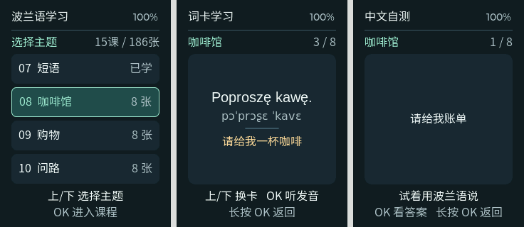

**English** · [简体中文](README.zh_CN.md)

# Pocket Polish for AI Passport

Learn Polish offline with 186 spoken flashcards across 15 topics. Each card pairs Polish with a Chinese meaning, an IPA transcription and a pronunciation clip. On startup, the device opens the topic list.



## What you can practise

The first seven topics cover greetings, numbers, colours, food, family, verbs and everyday phrases. Eight further topics add 64 cards on cafés, shopping, directions, public transport, time, hotels, introductions and sentence patterns.

Some cards work together. In the time lesson, *Która godzina?* asks “What time is it?” and *Jest ósma.* answers “It’s eight.” In the sentence-pattern lesson, compare *Mam czas.* (“I have time”) with *Nie mam czasu.* (“I don’t have time”) to hear how the ending changes in the negative sentence.

## Study and test yourself

| Screen | Controls |
| --- | --- |
| Topics and modes | Press UP or DOWN to highlight a choice. Press OK to open it. |
| Study cards | UP and DOWN move within the topic and play the new card. OK repeats its pronunciation. |
| Self-test | Read the Chinese prompt and say the Polish aloud. Press OK to reveal the Polish and IPA and hear the answer. Press OK again to listen a second time. |
| After revealing an answer | Press UP for another try or DOWN if you remembered it. Each card appears once per round. |
| Round results | Press OK to practise just the cards you marked for another try. After you remember all of them, OK starts a fresh round with the whole topic. |

Hold OK to go back one level. The device remembers the last topic you opened and marks a topic complete once you recall every card, including any retries. Individual answers and the current round last until you leave the quiz or restart the device.

## Build the firmware

Activate ESP-IDF 5.5.3, then run the following from the repository root.

```sh
./tools/validate.sh
```

The command runs the host tests and builds and verifies the merged image at `build/FoloToy-AI-Passport-full.bin`. A merged flash can reset stored learning progress. For environment setup, build details and options to preserve stored data, see the [setup guide](docs/development/engineering/environment-setup.md), [build guide](docs/development/engineering/build-and-test.md) and [flash layout](docs/development/engineering/firmware-layout.md#flashing-and-stored-data).

## Repository layout and license

`main/` implements the course and learning interface. `components/bsp/` contains the AI Passport board drivers. `assets/` includes the audio and font bitmaps used in the build. The hardware examples, host tests and build tools live in `examples/hardware/`, `tests/` and `tools/` respectively.

This project builds on FoloToy AI Passport and retains the upstream MIT license and copyright notice. The asset inventory records the font licenses and battery profile source. [Upstream project](https://github.com/FoloToy/ai-passport) · [MIT license](LICENSE) · [Asset notices](assets/README.md) · [Developer documentation](docs/README.md)
