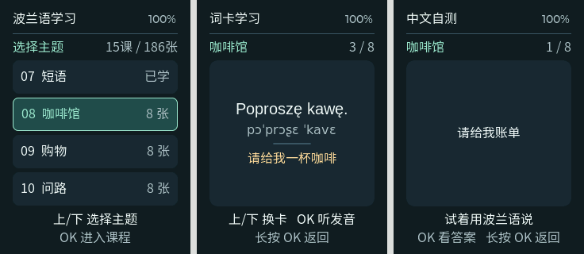

[English](README.md) · **简体中文**

# AI Passport 随身波兰语

开机进入主题目录，离线学习 15 个主题、186 张有声卡片。每张卡都有波兰语、中文释义、国际音标（IPA）和发音。



## 学习内容

前七个主题涵盖问候、数字、颜色、食物、家庭、动词和实用短语。新增八个主题共 64 张卡，涵盖咖啡馆、购物、问路、乘车、时间、住宿、自我介绍和日常句型。

有些卡片适合连起来练。在时间主题中，用 *Która godzina?*（现在几点？）提问，用 *Jest ósma.*（现在八点。）回答。在日常句型中，对照朗读 *Mam czas.*（我有时间。）和 *Nie mam czasu.*（我没有时间。），听一听否定句中词尾的变化。

## 学习与自测

| 页面 | 操作 |
| --- | --- |
| 主题与模式 | 按 UP 或 DOWN 选择，按 OK 进入。 |
| 学习卡片 | 按 UP 或 DOWN 在当前主题内翻卡，听新卡片的发音。按 OK 重听。 |
| 自测 | 看中文提示，先试着用波兰语说出来。按 OK 查看波兰语和音标，并听发音。再按 OK 可重听。 |
| 核对答案 | 还想再练就按 UP，已经记住就按 DOWN。每张卡在一轮中只出现一次。 |
| 本轮结果 | 按 OK 集中复习标记为“再练”的卡片。全部记住后，按 OK 可重新练习整个主题。 |

长按 OK 返回上一级。重新开机时，目录会选中上次打开的主题。把本主题的卡片都答会后，目录会保留完成标记，经过多轮复习也算完成。退出自测或重启设备会结束当前轮次，清除本轮的逐题作答记录。

## 构建固件

激活 ESP-IDF 5.5.3 环境后，在仓库根目录运行以下命令。

```sh
./tools/validate.sh
```

这条命令会运行主机测试，构建并校验合并固件 `build/FoloToy-AI-Passport-full.bin`。刷入合并固件可能会重置学习进度。环境配置、构建步骤和保留已有数据的刷写方式见[环境准备](docs/development/engineering/environment-setup.zh_CN.md)、[构建与测试](docs/development/engineering/build-and-test.zh_CN.md)和[固件布局](docs/development/engineering/firmware-layout.zh_CN.md#烧录与已存数据)。

## 项目结构与许可

`main/` 实现波兰语课程与学习界面，`components/bsp/` 包含 AI Passport 的板级驱动，`assets/` 存放可直接构建的音频与字库。硬件演示源码位于 `examples/hardware/`，主机测试和构建工具分别位于 `tests/` 和 `tools/`。

本项目基于 FoloToy AI Passport，沿用上游 MIT 许可与版权声明。字体许可和电池参数来源记录在资源清单中。[上游项目](https://github.com/FoloToy/ai-passport) · [MIT 许可](LICENSE) · [资源与许可](assets/README.zh_CN.md) · [开发文档](docs/README.zh_CN.md)
